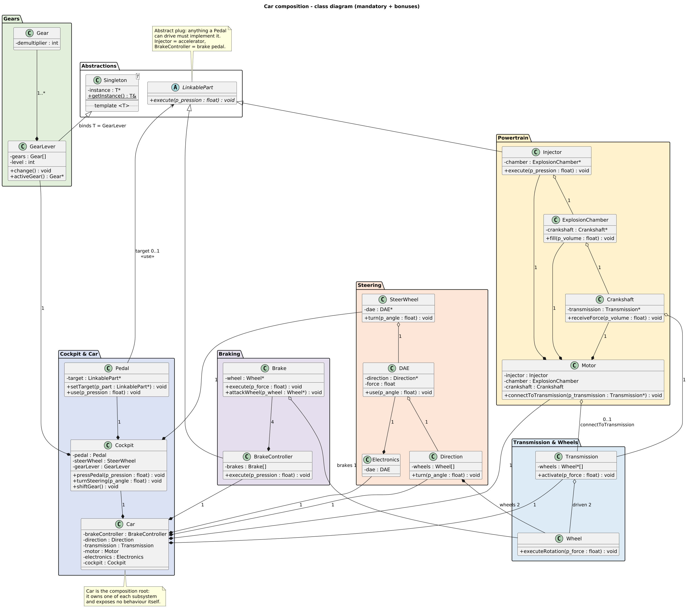

# Piscine Object

Implementation of the 42 **Piscine Object** subjects, in C++98.

| Module | Subject | Subject file | Exercises |
|---|---|---|---|
| 00 | Encapsulation | [`module00/po_module00_subject.pdf`](module00/po_module00_subject.pdf) | `ex00`, `ex01` |
| 01 | Relationship | [`module01/po_module01_subject.pdf`](module01/po_module01_subject.pdf) | `ex00` |
| 02 | UML | [`module02/en.subject.pdf`](module02/en.subject.pdf) | `ex00` |

Both are built with `-Wall -Wextra -Werror -std=c++98`, use no library outside
the standard one, and never allocate raw memory.

## Build and run

The three Makefiles form a chain, each one forwarding the goals to the level
below. `make` at the root builds everything:

```
make (root)  ->  make (moduleXX)  ->  make (moduleXX/exYY)
```

```bash
make                       # builds every exercise of every module
make -C module01           # only module 01
make -C module01/ex00      # only one exercise
make re                    # fclean + all, forces a full rebuild
make clean                 # removes the .o files
make fclean                # clean + removes the executables

./module00/ex00/ex00       # runs the bank
./module00/ex01/ex01       # runs the graph
./module01/ex00/ex00       # runs the relationships
```

Module 02 has no binary: `make -C module02/ex00` regenerates the PNGs from
the committed `.puml` sources when PlantUML is installed (`plantuml` on PATH
or `PLANTUML_JAR` pointing at `plantuml.jar`), and otherwise just checks the
committed PNGs are present. `clean`/`fclean` never delete the PNGs, they are
the deliverables.

> **Note about `module00/ex01`:** it reads `points.txt` for the file-loading
> bonus, so it must be launched from inside `ex01/`, or the file will not be
> found. A missing file is reported as a clean error, not a crash.

---

# Module 00: Encapsulation

An introduction to Object-Oriented Programming in C++, focused on encapsulation, access control, class responsibilities, and data integrity.

## Exercise 00 — the bank

`Account` and `Bank` come from the subject's `DivideAndRule.cpp`, where every
attribute was public. The exercise is to seal both classes so that no illogical
action is possible, so basically, **an account's internal state must never be modified directly from outside the bank**

### What is encapsulation
Encapsulation is a core principle of Object-Oriented Programming (OOP). It means bundling data (variables) and methods (functions) into a single unit (a class) and restricting direct access to some of the object's components

### Example Output

```
=== Creation of the bank ===
Liquidity : 999

=== Account creation ===
[0] - [100]

=== Deposit 400, the bank keeps 5% ===
Alice now owns : 480
Bank liquidity : 1019

=== Loans ===
Loan of 200 granted : 1 (true)
Alice now owns : 680
Loan of 100000 granted : 0 (false)
Liquidity untouched : 819
```

The bank applies a 5% commission to every deposit.
| Operation | Calculation | Result |
|---|---|---|
| Commission      | 400 * 0.05 | 20   |
| Amount credited | 400 - 20   | 380  |
| Alice's balance | 100 + 380  | 480  |
| Bank liquidity  | 999 + 20   | 1019 |

The commission is calculated inside deposit(), not by caller. 
This ensures that external code cannot bypass the commission or modify account balances directly through the public interface.

### The public surface

```cpp
class Bank
{
    class Account
    {
    public:                            // Read-only, const getters only
        int getId() const;
        int getValue() const;
    private:                           // Bank is the only class allowed in here
        Account(int id, int value);
        int _id;
        int _value;
        friend class Bank;
    };

    explicit Bank(int liquidity);
    Bank(const Bank&);                 // Declared, never defined: a bank cannot be copied
    Bank& operator=(const Bank&);

    int                operator[](int id) const;
    const Account&     getAccount(int id) const;
    int                getLiquidity() const;
    size_t             getNbAccounts() const;

    void createAccount(int id, int value);
    void deleteAccount(int id);
    void deposit(int id, int amount);
    bool giveLoan(int id, int amount);
    void print(std::ostream& os) const;
};
```

> **Note about `ex00`:** There is deliberately **no `Account.hpp`** in `ex00`.
> The bonus requires the account to be *internal* to the bank, and a nested class
> must be declared, so it cannot live in a header of its own.
> It is declared at the top of [`module00/ex00/Bank.hpp:38`](module00/ex00/Bank.hpp).

## Exercise 01 — the graph
A small 2D graph system capable of storing points, generating lines, and displaying the result as ASCII art.

`Vector2` is a container for two `float` components. `Graph` holds a size and a list
of points, and renders them as ASCII art.

### What the program does

> With a file-loading bonus, from [`module00/ex01/points.txt`](module00/ex01/points.txt)
> The file format is one point per line as `x y`. Blank lines are skipped, and
> everything after a `#` is a comment. Every point still goes through `addPoint()`, so
> the bounds validation applies exactly as if the points had been typed in by hand.

### The public surface

```cpp
class Graph
{
public:
    Graph();
    explicit Graph(const Vector2& size);
    static Graph fromFile(const char* path, const Vector2& size);

    const Vector2&              getSize() const;
    const std::vector<Vector2>& getPoints() const;
    size_t                      getNbPoints() const;

    void addPoint(const Vector2& point);
    void addLine(const Vector2& from, const Vector2& to);
    void display(std::ostream& os) const;

private:
    bool hasPoint(float x, float y) const;
    void checkInside(const Vector2& point) const;

    Vector2                 _size;
    std::vector<Vector2>    _points;
};
```

## Error handling

The subject requires that the program never crashes, even when it runs out of memory.
Three things were done to make that true:

1. **No raw memory management.** There is no `new` and no `delete` anywhere. Every
   object is stored by value inside a standard container, which frees itself. An
   out-of-memory condition still throws `std::bad_alloc`, and it is caught by the
   outermost `catch` in `main` like any other standard exception.
2. **Every external input is validated at the boundary.** An unknown id, a
   non-positive amount, a negative opening balance, a point outside the grid, a
   missing file: all of them are rejected with a specific exception carrying a
   readable message.
3. **Every exception is handled.** Each misuse is wrapped in its own `try`/`catch`
   so the demonstration keeps going, and a final `catch` in `main` turns anything
   that slips through into a clean message and a non-zero exit code.

The exceptions used are the standard ones, from `<stdexcept>`:

| Exception | Thrown when |
|---|---|
| `std::out_of_range` | An account id or a graph point that does not exist |
| `std::invalid_argument` | A non-positive amount, a negative id or size, a taken id, a missing file |
| `std::overflow_error` | An account balance or a bank liquidity that would overflow |

---

# Module 01: Relationship

## Exercise 01 — What the program does

One exercise, `ex00`, built in four stages. Each stage introduces one relationship
between objects, and the four of them end up living in the same `Worker` class.

| § | What the subject asks | Relationship | How it is written |
|---|---|---|---|
| IV.1 | A `Worker` **contains** a `Position` and a `Statistic` | **Composition** | Two members stored **by value** |
| IV.2 | A `Shovel` is given to a worker, taken back, and **survives** the worker | **Aggregation** | A `Tool*` the worker only **borrows** |
| IV.3 | `Shovel` and `Hammer` share a `Tool` base with a pure virtual `use()` | **Inheritance** | `class Tool` abstract, two concrete children |
| IV.4 | A `Workshop` holds workers who sign up and leave freely | **Association** | `std::vector<Worker*>` in both classes |

The difference between the first two rows is the whole point of the module, and the
program prints it: a worker **destroys** his position and his statistic, and
**leaves behind** his shovel.

### IV.1 Composition

A `Worker` contains a `Position` and a `Statistic`, both created automatically when the worker is constructed.
```
[Worker]: Worker [position](1, 2, 3) is born, [statistic] level 3, 250 exp
```

### IV.2 Aggregation

A Worker can hold tools without owning their lifetime.
```
Worker(4, 5, 6) holds 1 tool(s)
Worker uses shovel to dig a hole (uses #1)
Worker(4, 5, 6) is leaving
The shovel outlived the worker, (1 uses so far)
```

That last line of the destructor is the proof: **nothing is deleted**, the tool
belongs to `main`, and the worker may vanish while holding one. Handing the same
shovel to a second worker removes it from the first one:

### IV.3 Inheritance

Shovel and Hammer inherit from Tool and implement their own use() behavior.

```
Worker(5, 5, 5) holds 2 tool(s)
Use hammer to breaka a rock (uses #1)
Use shovel to dig a hole (uses #2)
```

The two `use` lines come from the **same** call on the same `Tool*` array, the loop
cannot tell the two tools apart, and each one still behaves as itself.

### IV.4 Association

A Worker can join multiple Workshop objects, and each workshop can contain multiple workers.

```
Worker(1, 1, 1) joins "forest camp"
Worker(1, 1, 1) joins "mine"
Worker is now inside 2 workshops at once
```

One worker is inside two workshops at the same time, `work()` refuses to do
anything while he is registered nowhere, and the last two lines are the destructor
cleanup: a dying worker tells every workshop it belongs to, so no workshop is left
holding a pointer to freed memory.

## The public surface

```cpp
struct Position                              // IV.1, plain structure as the subject asks
{
    int x, y, z;
    Position(int x, int y, int z);
};

struct Statistic
{
    int level, exp;
    Statistic(int level, int exp);
};

class Tool                                   // IV.3, abstract, cannot be instantiated
{
public:
    virtual            ~Tool();             // VIRTUAL, mandatory to delete through Tool*
    virtual void       use(void) = 0;       // pure virtual
    virtual std::string getToolName(void) const = 0;

    int        getNumberOfUses(void) const;
    Worker*    getHolder(void) const;

protected:
    Tool(void);                             // only a derived tool may be built
    void       _countUse(void);             // the only writer of the counter

private:
    Tool(const Tool&);                      // declared, never defined: a tool cannot
    Tool& operator=(const Tool&);           // be copied, it has an identity

    friend class Worker;
    void       _setHolder(Worker* holder);

    int         _numberOfUses;
    Worker*     _holder;                    // 0 = the tool is on the shelf
};

class Shovel : public Tool { /* ... */ };    // IV.2 and IV.3
class Hammer : public Tool { /* ... */ };    // IV.3, exists to justify the base class

class Worker                                 // the four relationships meet here
{
public:
    Worker(const Position& coordonnee, const Statistic& stat);
    Worker(const Worker&);                  // declared, never defined
    Worker& operator=(const Worker&);
    ~Worker();                              // clears the back references, deletes nothing

    const Position& getCoordonnee(void) const;
    const Statistic& getStat(void) const;
    std::string     getLabel(void) const;

    void   giveTool(Tool* tool);            // AGGREGATION, steals it if held
    bool   takeTool(Tool* tool);
    size_t getNbTools(void) const;
    bool   hasTool(const std::string& name) const;

    template <typename ToolType>            // BONUS 1, body must stay in the header
    ToolType* getTool(void);                // first tool of that type, or 0

    bool   isRegisteredTo(const Workshop* workshop) const;
    size_t getNbWorkshops(void) const;
    bool   work(void);                      // does nothing when registered nowhere

private:
    friend class Workshop;                   // the other half of the association
    void        _forgetWorkshop(Workshop* workshop);
    void        _checkWorkshops(void);       // BONUS 3
    std::string _label(void) const;

    const Position           _coordonnee;   // COMPOSITION, by value, const
    const Statistic          _stat;         // COMPOSITION, by value, const
    std::vector<Tool*>       _tools;        // AGGREGATION, non owning
    std::vector<Workshop*>   _workshops;    // ASSOCIATION, non owning
};

class Workshop                               // IV.4
{
public:
    Workshop(const std::string& name);
    Workshop(const std::string& name, const std::string& requiredTool);   // BONUS 2
    Workshop(const Workshop&);              // declared, never defined
    Workshop& operator=(const Workshop&);
    ~Workshop();                            // clears the back references, deletes nothing

    const std::string& getName(void) const;
    const std::string& getRequiredTool(void) const;
    size_t             getNbWorkers(void) const;
    bool               hasWorker(const Worker* worker) const;

    bool enrolWorker(Worker* worker);        // refuses without the required tool
    bool releaseWorker(Worker* worker);
    void executeWorkDay(void);

private:
    friend class Worker;                     // the other half of the association
    bool        _findWorker(const Worker* worker, size_t& index) const;
    bool        _hasRequiredTool(const Worker& worker) const;
    void        _checkWorker(Worker& worker);   // BONUS 3

    std::string             _name;
    std::string             _requiredTool;  // empty means anybody is welcome
    std::vector<Worker*>    _workers;       // non owning
};
```

### Bonus 1 — `GetTool<T>()`

Implemented as a template member in [`module01/ex00/Worker.hpp:104`](module01/ex00/Worker.hpp),
`dynamic_cast` on every tool of the toolbox.
- Returns the first matching tool.
- Returns `0` if no match is found.
- Implemented in `Worker.hpp` for template visibility.

### Bonus 2 — Tool Requirements

`Workshop` can require a specific tool before accepting a worker.

```
Worker(2, 2, 2) is turned away
Give tool to worker(2, 2, 2), now holds 1 tool(s)
Worker(2, 2, 2) joins "kitchen garden" (1 worker(s) inside)
```

### Bonus 3 — Automatic Workshop Release

When a worker loses a required tool, the workshop automatically removes them.
Every worker keeps a back reference to the workshops it belongs to, and every change
to the toolbox asks each of them to re-check the worker. 
The implementation is in [`module01/ex00/Workshop.hpp:100`](module01/ex00/Workshop.hpp) and the erasure of both sides happens there

```
Worker(2, 2, 2) puts the shovel back (0 tool(s) left)
Workshop checks worker(2, 2, 2), they no longer have a shovel, released from "kitchen garden"
Worker is down to 0 workshop(s), "kitchen garden" let them go on its own
```

## Design notes

- **Nobody owns a tool.** `main` creates the `Shovel` and the `Hammer` on its own
stack and the workers only receive pointers

- **The back references are what keep the lists consistent.** `Worker::_workshops` and
`Workshop::_workers` are two halves of one relationship, and each class edits **its
own** vector through a private method guarded by `friend`

- **Two loops iterate backwards, on purpose.** Going backwards
makes the erasure safe in `releaseWorker()`, a forward iterator in `Worker::_checkWorkshops()` would be invalidated.

- **A copy is refused by a link error.** `Worker`, `Tool` and `Workshop` all declare a
copy constructor and a copy assignment and never define them

## Error handling

The same approach as module 00, applied to the new objects:

1. **No raw memory.** No `new`, no `delete`, no owning pointer. A `std::bad_alloc`
   from a growing `std::vector` is caught by the outermost `catch` in `main` like
   any other standard exception.
2. **Every input is validated where it enters.** A negative coordinate, a negative
   level, an empty required tool name, a null tool, a null worker: each one is
   rejected at the boundary by the object that owns the data.
3. **Every exception is caught individually**, so the demonstration always runs to
   the end:

> A `takeTool()` for a tool the worker does not hold is **not** an exception: the
> requested state is already the current one, so it returns `false` and prints a line.

| Exception | Thrown when |
|---|---|
| `std::invalid_argument` | A negative coordinate, level or exp, an empty required tool name, a null tool, a null worker |

---

# Module 02: UML

One exercise, `ex00`, with no code: a class diagram of a car, drawn in PlantUML
([`module02/ex00/subject.puml`](module02/ex00/subject.puml), rendered to
[`module02/ex00/subject.png`](module02/ex00/subject.png)). All four bonuses are
done, folded into the same deliverable plus three sequence diagrams.

## What each shape in the PNGs means

### Class diagram (`subject.png`)

| Shape | Meaning | Example in the diagram |
|---|---|---|
| Rectangle with green `C` | Concrete class | `Motor`, `Wheel`, … |
| Rectangle with blue `A` | Abstract class, cannot be instantiated | `LinkablePart` |
| Top compartment | Class name (`"Singleton<T>"` = template class) | every box |
| Middle compartment | Attributes, `-` = private | `-chamber : ExplosionChamber*` |
| Bottom compartment | Methods, `+` = public | `+execute(p_pression : float) : void` |
| *Italic* + `{abstract}` | Must be overridden by the children | `LinkablePart.execute()` |
| `.. template <T> ..` | Template parameter, shown as a separator note | inside `Singleton` |
| Hollow triangle arrowhead | Inheritance / realisation, points at the parent | `Injector` \rightarrowtriangle  `LinkablePart` |
| Filled diamond | **Composition**: the diamond owner stores the other **by value** and destroys it | `Motor` \rightarrowblackdiamond  `Injector` |
| Hollow diamond | **Aggregation**: the diamond owner only **borrows** a pointer, never deletes it | `Transmission` \rightarrowwhitediamond  `Wheel` |
| Plain open arrow | Use-dependency (`<<use>>` = call through an interface) | `Pedal` \rightarrow  `LinkablePart` |
| Label mid-link | Multiplicity or role | `1`, `2`, `4`, `1..*`, `0..1`, `driven 2`, `target` |
| Tabbed folder around classes | Package = one functional block, colour-coded | `Powertrain`, `Braking`, … |
| Yellow sticky note | Design rationale, not code | the notes on `LinkablePart` and `Car` |

## How the `.puml` files are written

PlantUML turns plain text into the PNGs (`plantuml -tpng file.puml` writes
`file.png` beside it). The `.puml` sources stay in the repo so anyone can
re-render or diff them. Writing order, step by step:

## The class diagram



## Regenerating the PNGs

```bash
make -C module02/ex00            # no-op check without PlantUML
plantuml -tpng module02/ex00/subject.puml   # explicit render
PLANTUML_JAR=/tmp/plantuml.jar make -C module02/ex00
```
